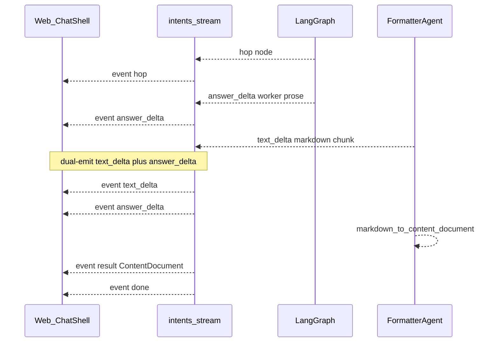

# Evolution Palatium AI → Big Tech 2026

Обновлено: 2026-10-13. Автор входа: VabGen.
Статус: **Phase 1 + 4 + 3 + 2 done on master**; **Pre-Phase 5 hardening in progress**
(норматив — 000/020/030/040/060/065/070/075/080/084; при противоречии **правила побеждают**).
Следующие: Pre-Phase 5 SRP → Phase 5+.

Ветка Phase 1: `big-tech-evolution/phase-1` (merged).
PR Phase 1: план + тонкое правило + полная реализация Hybrid Streaming Markdown.
Phase 4: Neo4j schema bootstrap + dynamic LLM timeouts + DTZ audit (уже UTC).
Phase 3: LiteLLM tier registration + CostTracker + gen_ai.* spans.
Phase 2: attachment overlap + Formatter 8s fallback; parallel workers/L1 cache уже были.

**Pre-Phase 5 (не Phase-N):** SRP split `researcher` (~641 LOC) и `formatter` (~452 LOC)
внутри существующих пакетов; граф и контракты `BaseAgent`/registry не меняются.
Branch/PR tag: `big-tech-evolution/pre-phase-5-srp`. Phase 5 (Presidio / constitutional
critic / red-team) стартует только после зелёного SRP.

**Tooling:** poetry → uv; lock = `uv.lock` (025).

---

## 1. Проблема

Продукт уже имеет SSE (`hop` / `answer_delta` / `result` / `done`) и early TTFT через
worker prose ([`docs/architecture/streaming.md`](../../docs/architecture/streaming.md)),
но Formatter в проде компилирует `ContentDocument` через `json_schema` без user-visible
Markdown-токенов. На сложных RAG-ходах пользователь долго видит только черновик
worker'а или ждёт финальный `result`. Цель эволюции — живой Markdown-стрим уровня
Vercel AI SDK / Claude, без ломки персистентного контракта `ContentDocument` и без
введения Qdrant (запрет **060** / ADR 0004).

---

## 2. Scope этого PR (Phase 1)

| В scope | Вне scope (следующие фазы / PR) |
|---|---|
| Канон: этот план + `.cursor/rules/evolution-to-big-tech.mdc` (принципы + ссылка) | Phase 2 parallel `Send()` workers |
| Hybrid SSE: worker → `answer_delta`; Formatter MD → `text_delta`; финал → `result` | Semantic cache beyond existing Redis L1 + LiteLLM |
| Dual-emit `answer_delta` + `text_delta` (один релиз миграции) | Presidio / PyRIT / deepeval golden-100 |
| `markdown_parser.py` → `ContentDocument` после стрима | Yjs Canvas / multimodal vision |
| Новый `FORMATTER_SYSTEM_PROMPT` (GFM + HITL XML tags) | Ломающий rename события `hop` |
| Фронт: GFM stream preview (лёгкий; без remark в IIFE — 084); финал — `BlockRenderer` | Правка `Dockerfile` / ломка `ci.yml` |
| Тест `tests/integration/test_formatter_markdown_stream.py` | Qdrant в compose |
| Обновить `docs/architecture/streaming.md` | — |

FinOps tier registration, Neo4j index bootstrap, dynamic timeouts — **зафиксированы как
решения roadmap** (§4); в Phase 1 PR включаем только то, что не раздувает scope сверх
Streaming Hybrid. Остальное — Phase 3/4 PR с тегом `big-tech-evolution/phase-N`.

**Исключение (минимальный FinOps в Phase 1, если блокирует приёмку стрима):** нет —
cost registration не нужен для Markdown stream DoD.

---

## 3. Утверждённые решения (1B + Hybrid)

1. **Streaming контракт — Hybrid**
   - Worker / fast-path prose → `answer_delta` (как сейчас; TTFT metric на первом чанке).
   - Formatter LLM → `response_format="text"`, стрим GFM → `text_delta` (`content` поле).
   - После стрима: `markdown_to_content_document(...)` → `ContentDocument` в `result`.
2. **Без ломающего rename:** имя события `hop` зафиксировано.
3. **Dual-emit на один релиз:** при Formatter markdown-чанках эмитить и `text_delta`,
   и совместимый `answer_delta` с тем же текстом (фронт может слушать любой; после
   миграции UI — deprecate dual в Phase 1.1 / follow-up).
4. **Phase 2 cache:** Redis L1 ([`response_cache_service.py`](../../src/palatium_ai/application/services/response_cache_service.py))
   + LiteLLM semantic cache (`deploy/litellm/config.yaml`, threshold 0.95). **Qdrant не вводим.**
5. **Neo4j indexes:** runtime Cypher bootstrap в application lifecycle (`bootstrap.py` /
   graph factory), не Alembic. Свойства `expired_at` уже в write-port — индексы и
   backfill NULL→sentinel только если warnings остаются.
6. **Timestamps:** только `datetime.now(UTC)` / `timezone.utc` (**050**).
7. **Timeout formula (Phase 4):** `min(max(base + prompt*0.01 + max_tokens*0.05, 5), 90)`.
8. **FinOps (Phase 3):** `litellm.register_model` для `openai/tier-small|mid|frontier`
   (+ embedding) в startup `bootstrap.py`, чтобы убрать `llm.cost.missing` по `tier_alias`.

---

## 4. Глобальные принципы (норма тонкого правила)

Кодируются в `.cursor/rules/evolution-to-big-tech.mdc` (`alwaysApply: false`,
description для agent-requestable):

1. Streaming-First для UI-facing LLM (TTFT ≤ 500 ms на trivial path).
2. JSON/`ContentDocument` — persistence + internal; SSE UI — Markdown (+ custom XML tags).
3. Parallel over sequential where no data-dependency (`Send()` — Phase 2).
4. Fail fast, fall back gracefully (worker prose / fallback stream).
5. Every token has a price (tier cost registration — Phase 3).
6. OpenTelemetry GenAI SemConv (`gen_ai.*` — Phase 3).
7. No hardcoded LLM timeouts — dynamic formula (Phase 4).

Порядок фаз: **1 → 4 → 3 → 2 → 5 → 6 → 7** (Phase 1 — блокер продукта).

---

## 5. Целевой SSE-контракт (Hybrid, Phase 1)



| Event | Payload | Emitter | Notes |
|---|---|---|---|
| `hop` | `{node, task_id, thread_id}` | graph runner | unchanged name |
| `answer_delta` | `{delta, replace?}` | workers + dual from Formatter | TTFT metric unchanged |
| `text_delta` | `{content}` | Formatter markdown stream | new; primary for MD UI |
| `result` | `{result: FormatterTaskResult}` | intent_service | `ContentDocument` from parser |
| `error` | `{detail\|message, ...}` | router/service | unify shapes in follow-up OK |
| `done` | `{}` | router | unchanged |

**Не в Phase 1:** `action_delta`, stream `metadata` (HITL остаётся в `result` /
`ContentDocument.actions`). Могут появиться в Phase 1.1 без ломания Hybrid.

---

## 6. Реализация Phase 1 — файлы и шаги

### 6.1 Backend — Formatter Markdown stream

**Файлы:**
- [`src/palatium_ai/application/agents/formatter/agent.py`](../../src/palatium_ai/application/agents/formatter/agent.py)
- [`src/palatium_ai/application/agents/formatter/prompts.py`](../../src/palatium_ai/application/agents/formatter/prompts.py)
- **NEW** `src/palatium_ai/application/agents/formatter/markdown_parser.py`
- [`src/palatium_ai/application/agents/formatter/answer_delta.py`](../../src/palatium_ai/application/agents/formatter/answer_delta.py) (или соседний `text_delta.py`)
- [`docs/architecture/streaming.md`](../../docs/architecture/streaming.md)

**Поведение `_call_formatter_llm` / `_dispatch` (production stream path):**
1. Если bound `TurnSseBridge`: всегда `call_llm_stream` с `response_format="text"`,
   `response_model=None`.
2. `on_delta`: буфер markdown + emit `text_delta` `{content: chunk}` + dual
   `answer_delta` `{delta: chunk}` (без `replace` на каждом токене; `replace: true`
   только когда Formatter **сменяет** worker draft — один раз в начале Formatter stream,
   если уже были worker `answer_delta`).
3. После completion: `document = markdown_to_content_document(buffer, task_input)`.
4. Repair path: при parse failure — один repair LLM pass (text→markdown или structured
   fallback к существующему `parse_formatter_document` если модель вернула JSON).
5. Non-stream / no bridge: тот же text path + parse (единый SoT), без json_schema как
   primary. Debug `FORMATTER_DEBUG_STREAM_DELTAS` / `formatter_delta` — deprecate
   (оставить no-op или map на `text_delta`).

**Промпт:** заменить `FORMATTER_SYSTEM_PROMPT` на GFM + `<hitl-action>` /
`<hitl-choice>` / callouts / cite `[N]` (текст из авторского ТЗ, без JSON output).

**Parser (`markdown_parser.py`):**
- GFM headings, lists, tables, fenced code, blockquotes.
- `> [!NOTE|WARNING|DANGER|SUCCESS|INFO]` → `CalloutBlock`.
- `<hitl-action kind="confirm|choice|..." label="..." />` → document actions /
  interaction.
- `<hitl-choice options='[...]' />` → choice actions.
- `[1]`, `[2]` → `source_refs` / citation mapping from attachment context when available.
- Fallback: если буфер валидный JSON `ContentDocument` — старый `parse_formatter_document`
  (совместимость с кэшем/регрессией).
- Зависимость: `markdown-it-py` **только если** regex-parser не покрывает DoD; иначе
  regex + существующие pydantic-блоки (бюджет бандла фронта не затрагивает backend dep —
  решение: предпочесть stdlib/regex; добавить `markdown-it-py` при провале таблиц/nested).

### 6.2 Backend — SSE wiring

**Файлы:**
- [`intent_graph_runner.py`](../../src/palatium_ai/application/services/intent_graph_runner.py) —
  проброс `text_delta` как mid-bridge events (уже multiplex queue).
- [`intents.py`](../../src/palatium_ai/presentation/api/routers/intents.py) — без смены
  framing; новое имя события проходит generic mapper.
- Метрика TTFT: первый user-visible chunk — по-прежнему первый `answer_delta`
  (dual сохраняет metric); опционально record на первом `text_delta` если dual выключен
  позже.

### 6.3 Frontend

**Файлы:**
- [`web/src/api/client.ts`](../../web/src/api/client.ts) — handlers `onTextDelta`;
  парсинг `text_delta.content`; dual: предпочитать `text_delta` для preview, иначе
  `answer_delta`.
- [`web/src/components/ChatShell.tsx`](../../web/src/components/ChatShell.tsx) —
  stream preview: GFM source via `StreamMarkdownPreview` (`closeIncompleteMarkdown` +
  `stripHitlTags`). **Не** тянуть `react-markdown`/`remark-gfm` в widget IIFE.
  Hotfix 1.1: stream preview = `react-markdown` + `remark-gfm`; `BUDGET_KIB = 210` (084).
  Финальный message — `BlockRenderer` + `ContentDocument`; emoji → library icons.

HITL XML tags в preview: strip или render as muted placeholders; кликабельные карточки
только из серверных HITL в `result` (**020** — не доверять произвольным action tags
без server card).

### 6.4 Тесты и гейты

| Тест | Что доказывает |
|---|---|
| `tests/integration/test_formatter_markdown_stream.py` | stream emits `text_delta` (+ dual `answer_delta`); final `ContentDocument` from markdown; no json_schema required |
| unit parser cases | callouts, lists, hitl tags, cite `[N]`, JSON fallback |
| existing `test_answer_delta.py` / SSE lifecycle | не сломаны |
| `web/` vitest + Playwright E2E | stream preview + final BlockRenderer |
| `uv run ruff/mypy/pytest` + `npm run verify` | PR checklist |

### 6.5 Тонкое правило

**NEW** `.cursor/rules/evolution-to-big-tech.mdc`:
- frontmatter: `alwaysApply: false`, description «Big Tech evolution principles + phase order».
- ≤ ~80 строк: принципы §4, Hybrid SSE таблица, ссылка на этот план, запрет Qdrant,
  порядок фаз, «не трогать Dockerfile/ci.yml».
- Индекс [`099-project-map.mdc`](../../.cursor/rules/099-project-map.mdc): одна строка
  ссылки на план (не дублировать норму).

---

## 7. DoD Phase 1

- [x] Ветка `big-tech-evolution/phase-1` + план + правило + код (PR — после review).
- [x] Hybrid SSE: `answer_delta` (worker) + `text_delta` (Formatter MD) + dual-emit + `result`.
- [x] `hop` не переименован.
- [x] `ContentDocument` из markdown parser (JSON fallback для legacy).
- [x] Фронт: `text_delta` primary preview (GFM text); финал — `BlockRenderer`.
- [x] `docs/architecture/streaming.md` обновлён (Hybrid SoT).
- [x] Интеграционный тест markdown stream + unit parser.
- [ ] Playwright E2E / полный `npm run verify` — прогон перед merge.
- [x] TTFT path: dual сохраняет metric на первом `answer_delta` (в т.ч. dual).

---

## 8. Roadmap фаз 2–7 (не этот PR)

| Phase | Цель | SoT-адаптация vs исходный черновик |
|---|---|---|
| **2** Parallel + fast-path ✅ | gather fan-out; Formatter fallback >8s; attachment overlap | Cache = Redis L1 + LiteLLM semantic; **no Qdrant** — **done 2026-10-12** |
| **3** FinOps ✅ | `register_model` tiers; OTel `gen_ai.*`; CostTracker | `datetime.now(UTC)`; reuse `cost_budget.py` — **done 2026-10-12** |
| **4** Data hygiene ✅ | Neo4j index bootstrap; dynamic timeouts | Cypher in bootstrap/factory, not Alembic — **done 2026-10-12** |
| **Pre-5** SRP hardening | Split `researcher`/`formatter` into sibling modules (`mcp_path`, `llm_research`, `llm_stream`, `repair`); no new graph nodes | in-process only (000/030); not a Phase-N |
| **5** Safety | Presidio scrubber; constitutional critic; nightly red-team | HITL/020; PII не в traces; hooks on SRP module boundaries |
| **6** Evals | golden dataset + deepeval on prompt PRs | не ослаблять 075 |
| **7** Canvas / vision | Yjs CRDT; multimodal messages | отдельный ADR при необходимости |

Каждая фаза: PR tag `big-tech-evolution/phase-N`, review @VabGen.
Pre-Phase 5: tag `big-tech-evolution/pre-phase-5-srp`.

---

## 9. Enforcement

| Гейт | Где |
|---|---|
| Streaming contract documented | `docs/architecture/streaming.md` + этот план |
| No Qdrant | 060 + ADR 0004 + review |
| Quality | `scripts/ci_quality.py` / CI jobs |
| Frontend | `npm run verify` + Playwright |
| Coverage | `pyproject.toml` threshold |
| Conventional Commits | `feat(stream):` / `feat(formatter):` |

---

## 10. Открытые вопросы — закрыты

| Вопрос | Решение |
|---|---|
| Scope PR | 1B: план + Phase 1 Hybrid |
| SSE rename | Hybrid; keep `hop`; dual-emit |
| Qdrant | Forbidden; Redis + LiteLLM |
| Neo4j migrations | Runtime Cypher bootstrap |
| Timestamps | `datetime.now(UTC)` |
| CreatePlan tool | Файл плана = канон в `.cursor/plans/` (005) |

---

## 11. Чеклист агента перед merge Phase 1

```text
uv run ruff check .
uv run mypy .
uv run pytest -m "not live and not llm_live and not slow"
cd web && npm run verify
```

Coverage ≥ порога в `pyproject.toml`. Не трогать `Dockerfile`, не ломать `.github/workflows/ci.yml`.
Clean Architecture слои не нарушать.
